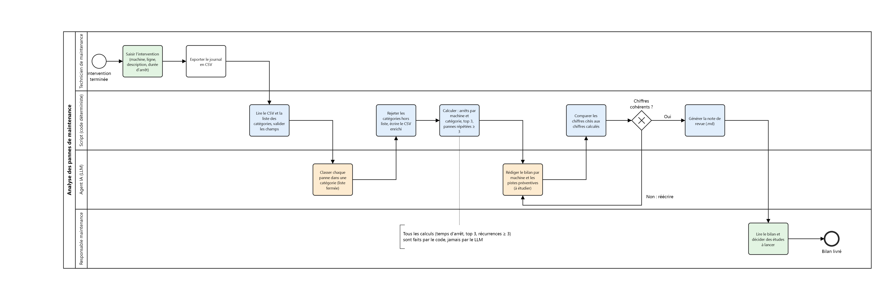

# Agent IA d'analyse des pannes de maintenance

Application en ligne de commande (Node.js) qui aide une usine (4 lignes, 12 machines) à analyser ses pannes :
les techniciens saisissent leurs interventions, un modèle Claude classe chaque panne dans une catégorie,
le code calcule toutes les statistiques, puis le modèle rédige un bilan par machine, contrôlé par le code.

> **Règle absolue : le code calcule, le modèle rédige.**
> Tous les chiffres (temps d'arrêt, top 3, pannes répétées) sont calculés en JavaScript.
> Le modèle ne fait que (1) choisir une catégorie dans une liste fermée et (2) rédiger à partir de chiffres fournis.
> Chaque nombre qu'il cite est vérifié par le code ; sinon il réécrit (3 essais maximum).

Les données sont **fictives** (usine « Fonderies Marchal », mars 2026).

---

## Démarrage rapide

### 1. Prérequis

- **Node.js 20.17 ou plus récent** (`node --version`). Téléchargement : https://nodejs.org
- **Git**
- **Une clé API Anthropic** : https://console.anthropic.com/ → *API Keys*.
  Seule l'option « Consulter le bilan » l'utilise ; la saisie et les tests fonctionnent sans.

### 2. Installation

```bash
git clone <url-du-depot> agent-pannes
cd agent-pannes
npm install
```

### 3. Configuration de la clé

Copier le modèle de configuration :

```bash
# macOS / Linux / Git Bash
cp .env.example .env
```

```powershell
# Windows PowerShell
Copy-Item .env.example .env
```

Puis ouvrir `.env` et coller la clé :

```
ANTHROPIC_API_KEY=sk-ant-...
ANTHROPIC_MODEL=claude-haiku-5-5
```

Le fichier `.env` est ignoré par Git : la clé ne sera jamais commitée.

### 4. Lancer

```bash
npm start
```

Un menu s'affiche (flèches ↑ ↓ puis Entrée) :

1. **Saisir une intervention** : date, ligne, machine, description, durée ; récapitulatif puis confirmation.
2. **Consulter le bilan** : classement, calculs, rédaction, contrôle, puis affichage et écriture de `out/bilan_revue.md`.
3. **Quitter**

Le journal fourni contient déjà 120 interventions : l'option 2 fonctionne dès le premier lancement
(environ 1 minute la première fois, le temps de classer les 120 pannes).

### 5. Vérifier que tout marche

```bash
npm test          # 38 tests, sans réseau ni clé API
```

---

## Commandes

| Commande | Effet |
|---|---|
| `npm start` (ou `node .`) | Lance le menu |
| `npm test` | Lance tous les tests (`node:test`), sans appel à l'API |
| `npm run seed` | Recrée `data/` à partir de `sources/` (refuse si le journal existe déjà) |
| `npm run seed -- --force` | Réinitialise `data/` : **efface les interventions saisies** et le classement mémorisé |

---

## Fonctionnement

Le flux suit le diagramme BPMN [`docs/maintenance_pannes.bpmn`](docs/maintenance_pannes.bpmn) :



| Étape BPMN | Qui | Module |
|---|---|---|
| Saisir l'intervention | Technicien | `src/saisie.js` |
| Lire le CSV et les catégories, valider | Code | `src/csv.js`, `src/pipeline.js` |
| Classer chaque panne (liste fermée) | LLM | `src/classifier.js` |
| Rejeter hors liste, écrire le CSV enrichi | Code | `src/classifier.js`, `src/csv.js` |
| Calculer arrêts, top 3, pannes répétées ≥ 3 | Code | `src/stats.js` |
| Rédiger le bilan et les points à étudier | LLM | `src/redacteur.js` |
| Comparer les chiffres cités aux chiffres calculés | Code | `src/controle.js` |
| Générer la note de revue (.md) | Code | `src/rapport.js` |

### Classement (LLM n° 1)

- Seuls l'`id` et la `description` de chaque intervention sont envoyés, par lots de 20.
- Le modèle répond via un outil dont le schéma impose un code parmi les 9 catégories (`enum`).
- Le code revérifie : code hors liste, id manquant ou en double → **une** nouvelle tentative, puis « À classer manuellement ».
- Les catégories sont mémorisées dans `data/journal_enrichi.csv` : un bilan suivant ne reclasse que les nouvelles saisies.
  Une catégorie corrigée à la main dans ce fichier est conservée.

### Calculs (code uniquement)

`src/stats.js` est un module pur (aucune lecture de fichier, aucun appel réseau), testé avec des cas calculés à la main :
temps d'arrêt par machine et par catégorie, total par machine et part du total, top 3 des machines,
pannes répétées (au moins 3 interventions de même catégorie sur une même machine).

### Rédaction et contrôle (LLM n° 2)

- Pour chaque machine, le modèle reçoit uniquement ses chiffres calculés (JSON) et rédige un bilan court
  et 1 à 3 **points à étudier** (jamais des décisions ni des ordres).
- `src/controle.js` extrait chaque nombre du texte (y compris « 1 410 », « 9,5 % », « quatre ») et vérifie
  qu'il existe dans les chiffres fournis. Un total, une moyenne ou une conversion faits par le modèle sont donc rejetés.
- En cas d'écart : nouvelle rédaction en signalant les nombres fautifs ; après 3 essais, erreur claire et pas de rapport.

---

## Arborescence

```
agent-pannes/
├── package.json         dépendances et commandes npm
├── .env.example         modèle de configuration (à copier en .env)
├── data/                ENTRÉES
│   ├── journal.csv          interventions : id,date,ligne,machine,description,duree_arret_min,categorie
│   ├── categories.csv       liste fermée des 9 catégories : code,libelle,description
│   ├── machines.csv         parc : ligne,machine
│   └── journal_enrichi.csv  (généré) journal avec les catégories
├── out/                 SORTIES
│   └── bilan_revue.md       (généré) la note de revue
├── sources/             données d'origine de l'exercice (ancien format), utilisées par « npm run seed »
├── docs/                diagramme BPMN (spécification du flux)
├── scripts/
│   └── seed.js              import de sources/ vers data/
├── src/
│   ├── index.js             point d'entrée, boucle du menu, gestion des erreurs
│   ├── menu.js              sélecteurs et saisies (inquirer)
│   ├── csv.js               lecture/écriture/validation des CSV
│   ├── saisie.js            option 1
│   ├── pipeline.js          option 2, enchaîne les étapes
│   ├── llm.js               client Anthropic, retries, erreurs en français
│   ├── classifier.js        classement par le LLM + vérification
│   ├── stats.js             calculs purs
│   ├── redacteur.js         rédaction par le LLM + boucle de réécriture
│   ├── controle.js          vérification des nombres cités
│   └── rapport.js           génération du .md
└── test/                stats, classement, contrôle, rédaction (faux modèle, sans réseau)
```

Le journal n'est jamais réécrit par le bilan : la catégorie est écrite dans `data/journal_enrichi.csv`.

---

## Dépannage

| Message | Cause et solution |
|---|---|
| `Clé API manquante` | `.env` absent ou `ANTHROPIC_API_KEY` vide → voir l'étape 3. Le `.env` doit être à la racine du projet. |
| `Clé API refusée (401)` | Clé invalide ou révoquée → en générer une nouvelle sur la console Anthropic. |
| `Modèle introuvable (404)` | Valeur de `ANTHROPIC_MODEL` incorrecte → remettre `claude-haiku-5-5`. |
| `Impossible de joindre l'API` | Pas de connexion, proxy ou pare-feu. |
| `Fichier introuvable : …/data/…` | Fichier de données supprimé → `npm run seed -- --force`. |
| `Journal invalide (…) : ligne N …` | Le CSV a été modifié à la main (souvent par un tableur) → corriger la ligne indiquée. |
| `chiffres incohérents après 3 essais` | Le modèle a cité 3 fois un nombre absent des données → relancer ; si cela persiste, essayer un modèle plus capable (`claude-sonnet-5-5`). |
| `npm install` échoue / erreur de syntaxe au lancement | Node.js trop ancien → installer la version 20.17 ou plus récente. |

**Coût indicatif** avec `claude-haiku-5-5` : quelques centimes pour un bilan complet de 120 interventions.

---

## Limites connues

- Le contrôle vérifie les **nombres**, pas le sens des phrases : une formulation qualitative (« l'essentiel des arrêts »)
  n'est pas vérifiable par le code. Le bilan reste à relire par le responsable maintenance.
- Le rédacteur ne reçoit que des chiffres, pas les descriptions des pannes : les points à étudier restent généraux.
- Les colonnes `heure`, `action` et `technicien` de l'export d'origine ne sont pas reprises telles quelles :
  le symptôme et l'action sont réunis dans `description`, le technicien n'est pas conservé.
